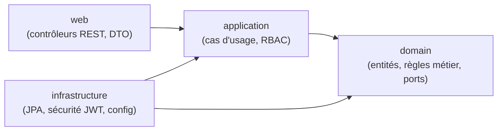

# TaskFlow

Outil de gestion de projets et de tâches **multi-utilisateurs** : projets, membres, tableau kanban, rôles et permissions.
Projet de portfolio conçu pour illustrer une architecture full-stack propre, sécurisée et testée.

[](../../actions/workflows/ci.yml)

> Remplacer `OWNER/REPO` dans le badge par le chemin GitHub du dépôt.

## Fonctionnalités

- Inscription / connexion, authentification **JWT** sans état
- **RBAC à deux niveaux** : rôle global (`USER`, `ADMIN`) et rôle par projet (`OWNER`, `MEMBER`, `VIEWER`)
- Projets, gestion des membres (invitation par email), tâches avec statut / priorité / assigné / échéance
- Tableau kanban (`TODO` → `IN_PROGRESS` → `DONE`)
- Espace administrateur (liste des utilisateurs)
- API REST versionnée (`/api/v1`), documentée avec OpenAPI/Swagger, erreurs au format RFC 7807

## Stack

| Couche | Technologies |
|---|---|
| Frontend | React 19, TypeScript, Vite, React Router, TanStack Query, Vitest + Testing Library |
| Backend | Java 21, Spring Boot 3.5, Spring Security (OAuth2 resource server / JWT), Spring Data JPA |
| Base de données | MySQL 8.4, migrations Flyway |
| Qualité | JUnit 5, Mockito, **ArchUnit**, **Testcontainers**, oxlint |
| CI/CD | GitHub Actions, Docker (multi-stage), Docker Compose |

## Architecture

Le backend suit la **Clean Architecture** : les dépendances pointent toujours vers le domaine, et cette règle est
**vérifiée automatiquement par ArchUnit** à chaque build.



Détails et décisions : [docs/architecture.md](docs/architecture.md) et [docs/adr/](docs/adr).

## Démarrage rapide

Prérequis : Docker.

```bash
cp .env.example .env        # puis remplacer les valeurs "change-me"
docker compose up --build
```

- Application : http://localhost:8081
- API : http://localhost:8080/api/v1 — Swagger UI : http://localhost:8080/swagger-ui.html
- Un compte administrateur est créé au démarrage si `ADMIN_EMAIL` et `ADMIN_PASSWORD` sont définis dans `.env`.

Développement local sans Docker pour l'appli (MySQL requis) : voir [docs/development.md](docs/development.md).

## Structure du dépôt

```
.
├── backend/          API Spring Boot (domain / application / infrastructure / web)
├── frontend/         SPA React + TypeScript (organisée par features)
├── docs/             Architecture, API, RBAC, base de données, ADR
├── .github/workflows CI (tests backend + frontend, build des images)
└── docker-compose.yml
```

## Documentation

| Document | Contenu |
|---|---|
| [docs/architecture.md](docs/architecture.md) | Couches, règle de dépendance, flux d'une requête |
| [docs/api.md](docs/api.md) | Référence des endpoints, format d'erreur |
| [docs/rbac.md](docs/rbac.md) | Matrice des rôles et permissions |
| [docs/database.md](docs/database.md) | Modèle de données (ERD), migrations |
| [docs/development.md](docs/development.md) | Installation, lancer, tester, CI/CD, déploiement |
| [docs/adr/](docs/adr) | Décisions d'architecture (ADR) |

## Feuille de route

- [ ] Refresh tokens et révocation
- [ ] Pagination et recherche des tâches
- [ ] Commentaires et historique d'activité
- [ ] Notifications (email / temps réel)
- [ ] Tests end-to-end (Playwright)
- [ ] Déploiement (publication des images, environnement de démo)

## Licence

Projet de démonstration. Ajouter une licence avant toute réutilisation.
