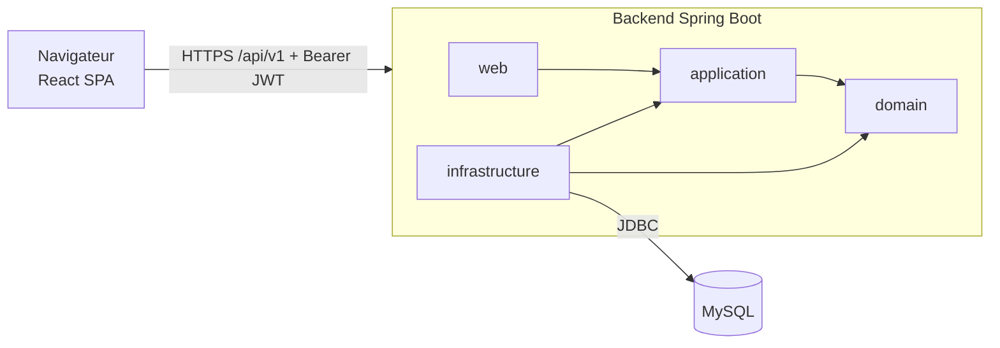
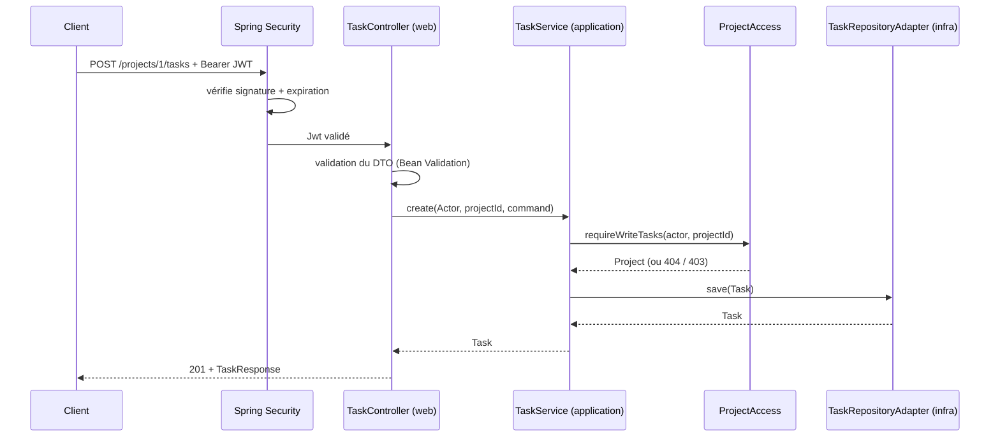

# Architecture

## Vue d'ensemble



En production-like (Docker Compose), nginx sert la SPA et relaie `/api/` vers le backend : le navigateur ne voit
qu'une seule origine. En développement, le proxy de Vite joue ce rôle.

## Backend : Clean Architecture

Code dans `backend/src/main/java/com/taskflow/`.

| Package | Rôle | Peut dépendre de |
|---|---|---|
| `domain` | Modèle métier (`User`, `Project`, `Task`, rôles), exceptions métier, **ports** de persistance (`*Repository`) | Rien (Java pur) |
| `application` | **Cas d'usage** (`AuthService`, `ProjectService`, `TaskService`), autorisation par projet (`ProjectAccess`), ports techniques (`PasswordHasher`, `TokenIssuer`) | `domain` |
| `infrastructure` | **Adaptateurs** : JPA (`persistence`), JWT + BCrypt + filtre de sécurité (`security`), câblage des beans (`config`) | `application`, `domain`, frameworks |
| `web` | Contrôleurs REST, DTO de requête/réponse, traduction des erreurs en RFC 7807 | `application`, `domain` |

### Règles appliquées (et testées)

`ArchitectureTest` (ArchUnit) fait échouer le build si :

1. `domain` dépend de Spring, Jakarta, Jackson ou d'une autre couche ;
2. `application` dépend de `web`, `infrastructure`, Spring Web/Data/Security ou JPA ;
3. `web` dépend directement de `infrastructure` ;
4. `infrastructure` dépend de `web`.

### Choix notables

- **Entités JPA distinctes des objets du domaine.** `UserJpaEntity`, `ProjectJpaEntity`, `TaskJpaEntity` sont
  package-private dans `infrastructure.persistence` ; chaque adaptateur convertit dans les deux sens. Le domaine
  ignore JPA.
- **Les cas d'usage n'ont pas d'annotation de stéréotype Spring.** Ils sont instanciés dans `UseCaseConfig`
  (composition root). Seule exception pragmatique : `@Transactional` (module `spring-tx`), autorisé par ArchUnit.
- **Pas d'interface « input port » par cas d'usage** : les contrôleurs appellent directement les classes de service.
  Le gain d'une interface supplémentaire est faible à cette taille ; elle pourra être ajoutée sans impact sur le domaine.
- **Autorisation à deux étages.**
  1. Spring Security : authentification JWT, accès `/api/v1/admin/**` réservé au rôle `ADMIN`.
  2. `ProjectAccess` (couche application) : droits par projet. Un non-membre reçoit `404` plutôt que `403`
     pour ne pas révéler l'existence d'un projet. Voir [rbac.md](rbac.md).

### Cycle d'une requête



## Frontend

Code dans `frontend/src/`, organisé **par fonctionnalité** :

```
app/          composition : providers, routes
features/
  auth/       AuthContext, pages login/register, ProtectedRoute (garde par rôle)
  projects/   liste des projets, tableau kanban, appels API
  admin/      pages réservées aux administrateurs
shared/
  api/        client HTTP typé (token, erreurs RFC 7807, gestion du 401), types des DTO
  ui/         composants transverses (Layout)
```

- **État serveur** : TanStack Query (cache, invalidation après mutation).
- **Session** : `AuthContext` ; le client HTTP déconnecte l'utilisateur automatiquement sur un `401`.
- **RBAC côté client** : masque les actions non permises (UX). **Ce n'est pas une barrière de sécurité** : l'API
  applique les mêmes règles.
