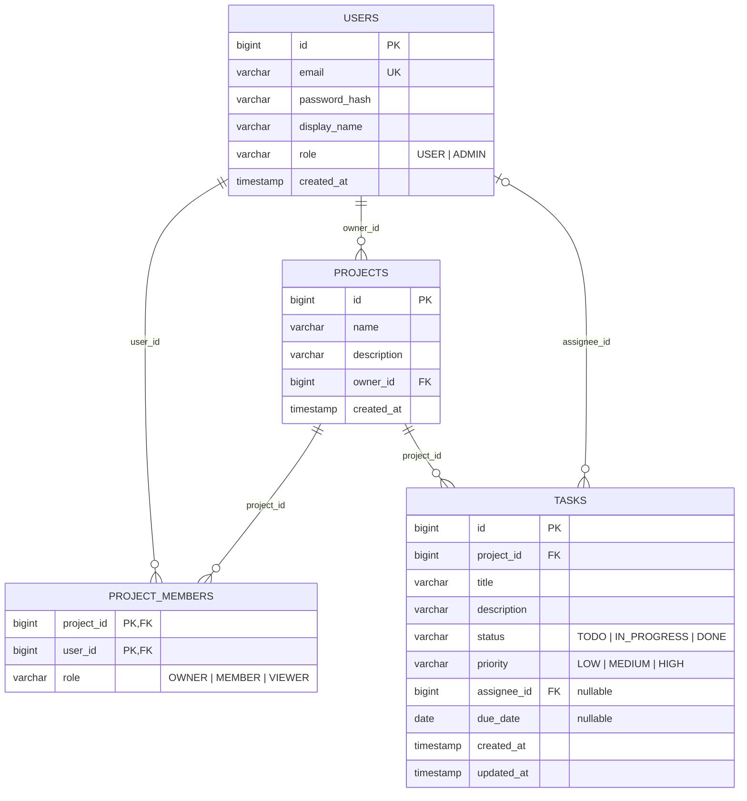

# Base de données

MySQL 8.4, schéma géré exclusivement par **Flyway** (`backend/src/main/resources/db/migration`).
Hibernate est en `ddl-auto: validate` : il vérifie le schéma au démarrage mais ne le modifie jamais.

## Modèle

## Contraintes et index

- `users.email` unique (les emails sont normalisés en minuscules par l'application).
- Suppression d'un projet : `ON DELETE CASCADE` vers `project_members` et `tasks`.
- Suppression d'un utilisateur assigné : `tasks.assignee_id` passe à `NULL`.
- Index `tasks(project_id, status)` (liste filtrée par statut) et `project_members(user_id)` (projets d'un utilisateur).

## Migrations

| Version | Contenu |
|---|---|
| `V1__init_schema.sql` | Tables `users`, `projects`, `project_members`, `tasks` + index |

Règles : ne **jamais** modifier une migration déjà appliquée ; ajouter `V{n+1}__description.sql`.

## Compte administrateur

Aucun mot de passe n'est stocké dans le dépôt. Au démarrage, si `ADMIN_EMAIL` et `ADMIN_PASSWORD` sont définis,
`AdminBootstrap` crée le compte `ADMIN` s'il n'existe pas encore (hash BCrypt).
