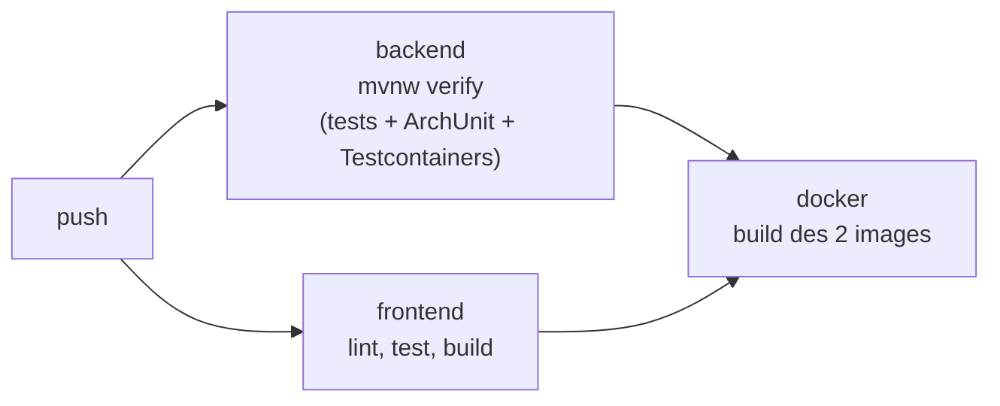

# Guide de développement

## Prérequis

| Outil | Version |
|---|---|
| JDK | 21 |
| Node.js | 22 |
| Docker | pour MySQL, Testcontainers et `docker compose` |

Maven n'est pas à installer : utiliser le wrapper `backend/mvnw` (`mvnw.cmd` sous Windows).

## Lancer en local

1. **Base de données** (seul MySQL via Compose) :
   ```bash
   cp .env.example .env
   docker compose up -d db
   ```
2. **Backend** :
   ```bash
   cd backend
   export DB_USER=taskflow DB_PASSWORD=<MYSQL_PASSWORD du .env>
   export ADMIN_EMAIL=admin@taskflow.local ADMIN_PASSWORD=<un mot de passe>   # optionnel
   ./mvnw spring-boot:run
   ```
   Les valeurs par défaut de `application.yml` visent `localhost:3306`, base `taskflow`.
3. **Frontend** :
   ```bash
   cd frontend
   npm install
   npm run dev          # http://localhost:5173, /api proxifié vers :8080
   ```

## Tout lancer avec Docker

```bash
docker compose up --build    # app: :8081, api: :8080, mysql: :3306
```

## Tests

| Commande | Portée |
|---|---|
| `cd backend && ./mvnw verify` | Unitaires, **règles d'architecture (ArchUnit)**, intégration |
| `cd frontend && npm test` | Vitest + Testing Library |
| `cd frontend && npm run lint` | oxlint |
| `cd frontend && npm run build` | Vérification TypeScript + build de production |

- `ApiIntegrationTest` démarre un vrai MySQL via **Testcontainers** : Docker doit tourner. Sans Docker, ce test est
  ignoré (et non en échec).
- Pour ajouter une règle d'architecture : `backend/src/test/java/com/taskflow/architecture/ArchitectureTest.java`.

## Variables d'environnement

| Variable | Défaut | Description |
|---|---|---|
| `DB_URL` / `DB_USER` / `DB_PASSWORD` | `localhost:3306/taskflow` | Connexion MySQL |
| `JWT_SECRET` | valeur **de dev uniquement** | Clé HMAC-SHA256, ≥ 32 caractères. **À définir hors développement** |
| `JWT_TTL_MINUTES` | `60` | Durée de vie du token |
| `CORS_ALLOWED_ORIGINS` | `http://localhost:5173` | Origines autorisées (séparées par des virgules) |
| `ADMIN_EMAIL` / `ADMIN_PASSWORD` | vides | Création du premier administrateur |

## CI/CD

Workflow : `.github/workflows/ci.yml`, déclenché sur chaque PR et chaque push sur `main`.



Le job `docker` construit les images sans les publier. Étape suivante naturelle : publier sur un registre
(GHCR) depuis `main`, puis déployer.

## Conventions

- **Backend** : ajouter un cas d'usage = classe dans `application`, port dans `domain/repository` si nouveau besoin
  de persistance, adaptateur dans `infrastructure/persistence`, contrôleur + DTO dans `web`. Toute évolution de
  schéma passe par une migration Flyway.
- **Frontend** : une feature = un dossier dans `features/` (API, pages, composants). Les types des DTO sont dans
  `shared/api/types.ts` et doivent rester alignés avec [api.md](api.md).
- **Sécurité** : ne jamais committer de secret ; `.env` est ignoré par Git.
